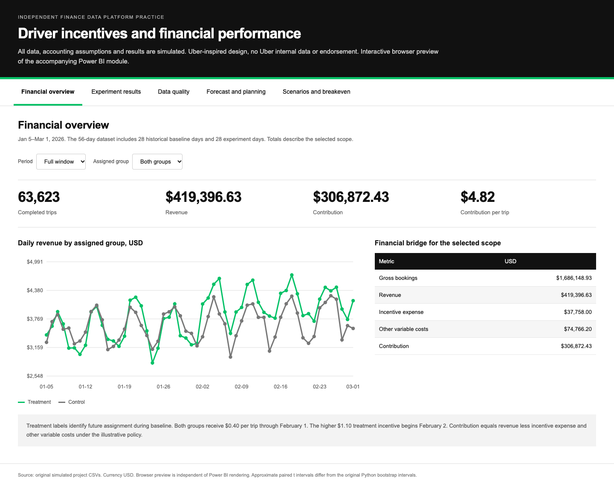
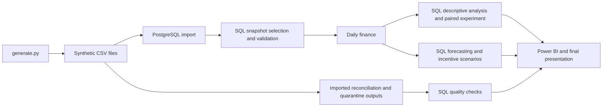
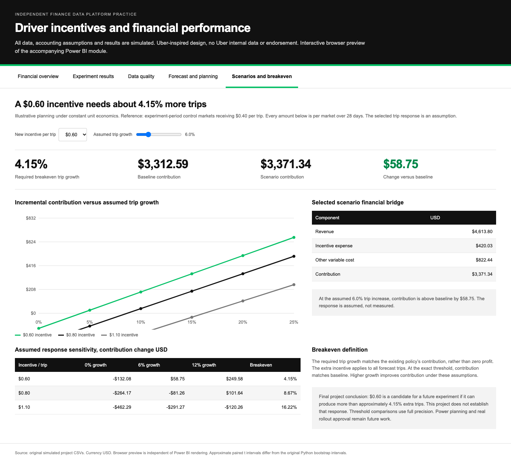

# Driver Incentives and Financial Performance

A reproducible financial data platform that evaluates whether higher per-trip driver incentives generate enough additional revenue to cover their cost.

**All data, assumptions and results are simulated. This independent case study uses no internal Uber data and makes no claim about Uber accounting policy or endorsement.**

[Results presentation](presentation/Driver_Incentives_Results.pptx) · [Experiment estimates](analysis/effect_summary.csv) · [Scenario results](analysis/scenarios.csv) · [Methods](docs/METHODS.md) · [Dashboard source](dashboard/index.html)



## Results

The simulated $1.10 incentive increased revenue before incentives, but the added revenue did not cover incentive expense and other variable costs. A lower $0.60 incentive has a smaller contribution-preserving volume threshold and remains a candidate for a future experiment.

| Outcome | Result | Scope |
|---|---:|---|
| Adjusted revenue effect | +$536.08 | Average per market over 28 days |
| Revenue approximate paired t 95% interval | $394.21 to $677.94 | 24 independent market pairs |
| Adjusted contribution effect | −$103.37 | Average per market over 28 days |
| Contribution approximate paired t 95% interval | −$203.04 to −$3.70 | No multiple-metric adjustment |
| Driver-model revenue MAE / WAPE | $314.18 / 3.90% | Seven-day holdout |
| Weekly benchmark revenue MAE / WAPE | $271.23 / 3.36% | Same holdout; lower error |
| Required trip growth for a $0.60 incentive | Approximately 4.15% | Preserves baseline contribution under fixed unit economics |

**The 4.15% threshold is a required response, not a predicted or experimentally established response to $0.60.** The simulator imposes a 12% expected treatment-volume multiplier for the tested $1.10 policy. These outcomes demonstrate a workflow rather than reveal real marketplace behavior.

## Workflow

Synthetic CSV generation uses `generate.py`. The analytical workflow imports those CSVs into PostgreSQL and runs the queries in [`sql/`](sql/). Power BI and the final presentation display the results.



Raw events contain replacement snapshots, repeated deliveries and refund updates arriving two days after service. Processing chooses one latest visible snapshot per trip before validation. Monetary source fields remain integer cents.

| Dataset | Rows | Grain |
|---|---:|---|
| Raw deliveries | 65,839 | One delivery event |
| Latest snapshots | 63,624 | One trip, including one invalid fixture |
| Valid completed trips | 63,623 | One accepted trip |
| Daily finance | 2,688 | Market × service date |
| Market assignments | 48 | Market, assigned within 24 pairs |

## Data generation

The supplied CSVs are already included. To regenerate the synthetic fixtures with Python 3.10 or newer:

```bash
python generate.py
```

The default seed is `20261115`. The generator writes events to `data/raw/` and the processed fixture exports to `data/processed/`. Its SQLite implementation files are isolated under `generation/sql/`; they are not the PostgreSQL analysis workflow.

The generator also emits diagnostic bootstrap and Monte Carlo results in `data/processed/results.json`. The reported experiment analysis instead uses the paired t method in `sql/test_result.sql`. The methods should not be mixed.

## PostgreSQL analysis

The analysis uses CSV imports and the original PostgreSQL queries in `sql/`, under schema **uber_project1**. It does not depend on a Python analysis script. The statements in `data_import.sql` are intended to be selected and run in stages, because table creation, CSV imports and checks are interleaved.

| Step | Query file | Work performed |
|---|---|---|
| 1 | [data_import.sql](sql/data_import.sql) | Create import tables, import CSVs using pgAdmin, then run schema and profile checks |
| 2 | [raw_to_daily_finance.sql](sql/raw_to_daily_finance.sql) | Select the latest valid snapshots and create daily_finance from raw deliveries |
| 3 | [data_process.sql](sql/data_process.sql) | Join market assignments and summarize baseline/control/treatment periods |
| 4 | [test_result.sql](sql/test_result.sql) | Calculate paired changes, mean effects, standard errors and approximate 95% t intervals |
| 5 | [reason_check.sql](sql/reason_check.sql) | Explain the revenue, incentive, other-cost and contribution bridge |
| 6 | [data_reconciliation.sql](sql/data_reconciliation.sql) | Inspect imported reconciliation discrepancies and market-day coverage |
| 7 | [data_quarantine.sql](sql/data_quarantine.sql) | Inspect the imported rejected record and its rule failures |
| 8 | [data_forecast.sql](sql/data_forecast.sql) | Calculate trip-based forecasts, actual comparisons and accuracy metrics |
| 9 | [optimize_strategy.sql](sql/optimize_strategy.sql) | Compare nine incentive scenarios and contribution-preserving growth thresholds |

[SQL execution and CSV mapping](docs/SQL_WORKFLOW.md) explains the staged imports and final SELECT options. The legacy SQLite `analysis.sql`, `models.sql` and `schema.sql` are not used as the PostgreSQL analytical path. The import-based reconciliation/quarantine checks inspect processed fixture outputs; they do not claim to rebuild an independent ledger.

`analysis/` contains checked-in report evidence, not an executable Python analysis workflow. Its filenames support the dashboard and slide references. Core effects, forecasts and scenarios can be checked with the SQL queries above. The Python tests validate CSV replay and report reference values as supporting checks.

## Experiment

- Baseline: January 5–February 1, 2026. All markets receive $0.40 per completed trip.
- Treatment: February 2–March 1, 2026. Control remains at $0.40; treatment receives $1.10.
- Assignment: one randomized treatment market within each of 24 matched pairs.
- Estimator: treatment change from baseline minus control change within each pair, averaged with equal pair weights.
- Statistical unit: independent market pairs, rather than individual trips.
- Financial interpretation: revenue before incentives is an outcome; contribution determines whether added revenue covers the modeled variable costs.

Market matching in the generator uses a shared synthetic demand structure. It does not implement a fitted real-data matching algorithm. The original 48-market design was not prospectively power-justified. The illustrative $100 contribution MDE / 80% power calculation gives approximately 44 pairs under a normal approximation and the simulated paired variance; a real test needs validated historical variance and a finalized design.

## Forecasting and scenarios

The driver model estimates weekday trip volume from the previous two weeks and multiplies it by weighted financial rates. Training ends February 22; February 23–March 1 is held out. A separate March 2–8 forecast has no observed actuals. The driver model supports financial decomposition but trails the weekly benchmark on this holdout. Neither model identifies a new incentive's causal response or provides a calibrated prediction interval.



Nine scenarios combine three incentive levels with three assumed trip responses. Incentives apply to all new-policy trips, including trips that would otherwise occur. Under constant revenue and other variable cost per trip:

```text
Required trip growth = (new incentive − existing incentive)
                       / (revenue per trip − other variable cost per trip − new incentive)
```

The $0.60 candidate requires 4.1528979105% additional trips to match baseline contribution. At an assumed 6% response, it adds $58.75 contribution per market over 28 days.

## Project display

- **Dashboard:** open `dashboard/index.html` locally. GitHub displays HTML source rather than executing the dashboard on a repository page.
- **Power BI:** open `powerbi/DriverIncentives.pbip` in Windows Desktop, set `DataFolder` to `powerbi/data`, and refresh. The checked-in CSVs are a versioned report snapshot. SQL results are inspected/exported separately; changing a SQL result does not automatically refresh those files. Native Desktop rendering and refresh are separate from structural checks.
- **Final presentation:** [download the 22-slide results deck](presentation/Driver_Incentives_Results.pptx). Visible slides and editable charts are preserved; private rehearsal notes are excluded from this publication copy.

## Repository map

```text
├── generate.py                 Synthetic CSV generation
├── generation/sql/             Internal SQLite generator definitions
├── data/raw/                   Delivered events and simulation reference data
├── data/processed/             CSV inputs for PostgreSQL analysis
├── sql/                        PostgreSQL queries used for the project
├── analysis/                   Checked-in report evidence and summaries
├── docs/                       Methods, data dictionary and SQL execution notes
├── tests/                      Supporting CSV and reference validation
├── powerbi/                    Native report and its CSV snapshot
├── dashboard/                  Standalone interactive report snapshot
├── assets/                     README previews
└── presentation/               Final results deck
```

## Assumptions and limitations

Revenue equals fare less base driver payable and platform-funded refunds. Incentives are an illustrative supplier expense. Contribution further deducts incentives and other variable costs and excludes fixed overhead. If incentives are instead contra-revenue, reported revenue changes while contribution stays the same when costs are deducted once.

The simulation excludes cancellation/payment status, cross-market interference, noncompliance, endogenous prices and long-term equilibrium. Refunds restate service-day economics rather than a posting-date ledger. The financial reference and events share simulated truth, so agreement is not independent accounting certification. The dashboard and slides are fixed presentation snapshots and do not automatically regenerate after data changes.
